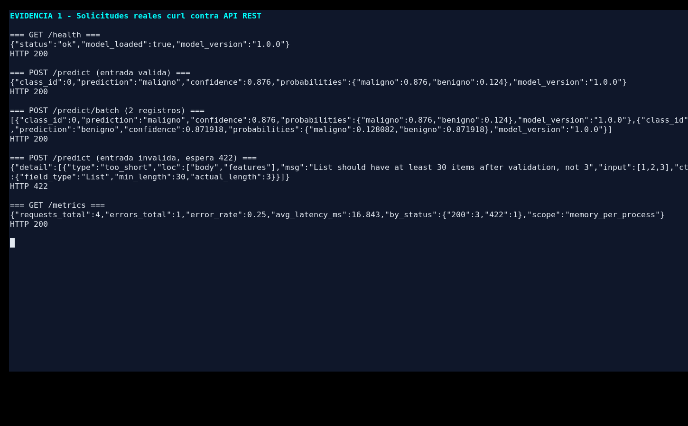
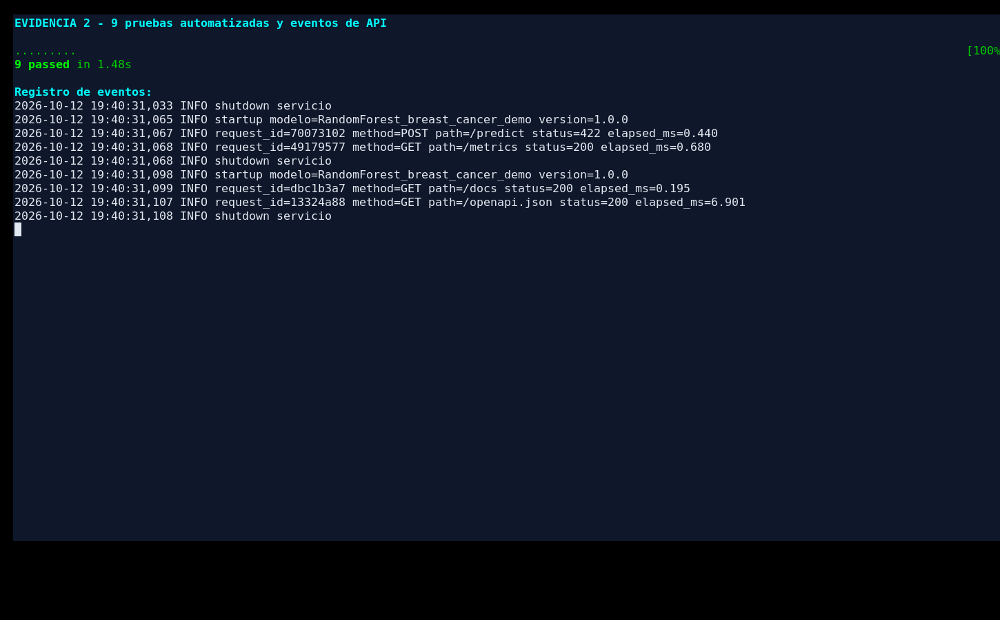

# Modelo de clasificación como servicio web con FastAPI

**Asignatura:** Toma de Decisiones  
**Estudiante:** Jhonatan David Pérez Siachoque  
**Institución:** Universidad Pedagógica y Tecnológica de Colombia  
**Entrega:** código fuente, notebook de Google Colab, pruebas cURL/Postman y evidencias.

## 1. Descripción y propósito

Esta práctica transforma un modelo de **clasificación Random Forest** en una **API REST** con FastAPI. Se utiliza el conjunto de datos *Breast Cancer Wisconsin (Diagnostic)* incluido en scikit-learn. Cada solicitud contiene **30 mediciones numéricas** en un orden establecido. La respuesta indica la clase estimada, su identificador y probabilidades por clase.

> **Uso exclusivamente académico.** No es un servicio clínico y sus resultados no deben utilizarse para diagnosticar o tomar decisiones médicas. Los datos están disponibles públicamente como ejemplo en scikit-learn.

Se eligió Random Forest y el mismo conjunto de datos utilizado en la actividad de MLflow anterior. **El artefacto aquí incluido se reentrenó para este proyecto** con una división de datos propia; sus métricas no deben confundirse con las de las ejecuciones anteriores en MLflow.

## 2. Archivos del repositorio

```text
fastapi_clasificacion_mlops/
├── README.md
├── requirements.txt
├── Dockerfile
├── .gitignore
├── app/
│   ├── __init__.py
│   └── main.py                  # Endpoints, validación, logs y métricas
├── scripts/
│   ├── train_model.py          # Entrenamiento reproducible
│   └── run_curl_tests.sh       # Pruebas HTTP reales con cURL
├── artifacts/
│   ├── model.joblib            # Modelo entrenado
│   ├── metadata.json           # Orden de variables, etiquetas, versión
│   └── training_report.json    # Resultados de evaluación
├── examples/
│   ├── sample_request.json     # JSON válido de una observación
│   └── batch_request.json      # JSON válido de dos observaciones
├── tests/
│   └── test_api.py             # 9 pruebas automatizadas
├── notebooks/
│   └── FastAPI_Clasificacion_Google_Colab.ipynb
├── postman/
│   └── API_Clasificacion.postman_collection.json
└── evidencias/
    ├── captura_pruebas_curl.png
    ├── captura_pytest_y_logs.png
    └── resultado_curl_real.txt
```

## 3. Requisitos y puesta en marcha (equipo local)

Recomendado: **Python 3.11–3.13**, con `pip` y `curl` instalados.

```bash
python -m venv .venv
# Windows PowerShell:
.venv\Scripts\Activate.ps1
# Linux / macOS:
# source .venv/bin/activate
pip install -r requirements.txt
```

El ZIP ya contiene un modelo entrenado. Para **reentrenarlo** desde cero:

```bash
python scripts/train_model.py
```

Iniciar la API desde la raíz del repositorio:

```bash
uvicorn app.main:app --host 127.0.0.1 --port 8000
```

Abrir **http://127.0.0.1:8000/docs** para explorar la documentación Swagger generada automáticamente por FastAPI. La descripción OpenAPI también se encuentra en **http://127.0.0.1:8000/openapi.json**.

Para ejecutar la misma práctica de manera guiada, abrir `notebooks/FastAPI_Clasificacion_Google_Colab.ipynb` en [Google Colab](https://colab.research.google.com/) y pulsar **Entorno de ejecución → Ejecutar todas**. Ese notebook instala sus dependencias, escribe los archivos necesarios, entrena el modelo, levanta el servidor local a Colab y realiza solicitudes HTTP.

**Alcance del despliegue:** en Colab la API escucha dentro de su propio entorno temporal; las llamadas `requests`/cURL del cuaderno funcionan contra `127.0.0.1`, pero esto **no** equivale a una API pública permanente. Para un despliegue público real se requiere un servidor, controles de seguridad, configuración y alojamiento independientes. El `Dockerfile` permite contenerizar el ejemplo si se cuenta con Docker.

## 4. Endpoints definidos

| Método | Ruta | Función | Respuesta normal |
|---|---|---|---|
| GET | `/` | Información de la API y rutas principales | `200` |
| GET | `/health` | Comprueba que el modelo esté cargado | `200` |
| GET | `/schema` | Orden de las 30 variables y etiquetas | `200` |
| GET | `/example` | Devuelve un JSON válido de ejemplo | `200` |
| POST | `/predict` | Predice para una observación | `200` |
| POST | `/predict/batch` | Predice de 1 a 100 observaciones | `200` |
| GET | `/metrics` | Total de solicitudes, errores y latencia media | `200` |
| GET | `/docs` | Interfaz Swagger/OpenAPI | `200` |

**Formato de entrada de `/predict`:**

```json
{ "features": [ /* exactamente 30 valores numéricos finitos */ ] }
```

El orden completo se obtiene mediante `/schema` y el ejemplo funcional mediante `/example`, o se utiliza el archivo `examples/sample_request.json`. **Las etiquetas de scikit-learn son 0 = maligno y 1 = benigno.**

**Ejemplo de respuesta real para el JSON del repositorio** (puede variar al reentrenar con configuraciones distintas):

```json
{
  "class_id": 0,
  "prediction": "maligno",
  "confidence": 0.876,
  "probabilities": {"maligno": 0.876, "benigno": 0.124},
  "model_version": "1.0.0"
}
```

## 5. Pruebas con cURL

Con el servidor en ejecución y estando en la raíz del proyecto:

```bash
# Verificar que el modelo cargó
curl http://127.0.0.1:8000/health

# Obtener un ejemplo válido
curl http://127.0.0.1:8000/example

# Predicción individual (Linux/macOS/PowerShell con curl real)
curl -X POST http://127.0.0.1:8000/predict \
  -H "Content-Type: application/json" \
  --data-binary @examples/sample_request.json

# Predicción por lotes
curl -X POST http://127.0.0.1:8000/predict/batch \
  -H "Content-Type: application/json" \
  --data-binary @examples/batch_request.json

# Solicitud errónea (esperado HTTP 422)
curl -i -X POST http://127.0.0.1:8000/predict \
  -H "Content-Type: application/json" \
  -d '{"features": [1, 2, 3]}'

# Indicadores
curl http://127.0.0.1:8000/metrics
```

**Windows PowerShell:** si `curl` se interpreta como alias, usar `curl.exe` y situarse en la carpeta raíz. Alternativamente, ejecutar las celdas de pruebas de Google Colab, que emplean `requests`.

Para automatizar todos los comandos en macOS/Linux/Colab:

```bash
bash scripts/run_curl_tests.sh
```

El archivo `postman/API_Clasificacion.postman_collection.json` puede importarse en Postman. Configurar la variable `baseUrl` si se usa un puerto diferente.

## 6. Registro, monitoreo y detección de errores

El middleware registra para cada llamada el **identificador de solicitud, método, ruta, código HTTP y duración** en milisegundos. Los eventos se guardan en `logs/servicio.log`, con rotación básica. **No se guardan los 30 valores de entrada** para evitar incorporar datos sensibles innecesariamente.

`GET /metrics` devuelve `requests_total`, `errors_total`, `error_rate`, `avg_latency_ms` y `by_status`. En la prueba cURL, una entrada de tres variables recibió **HTTP 422** por validación, quedó contabilizada como error y fue registrada en el archivo de eventos.

> Las métricas se almacenan **en memoria y por proceso**, se reinician al reiniciar el servidor y no equivalen a una solución de observabilidad de producción. Para producción: autenticación, HTTPS, control de tráfico, registros centralizados, Prometheus/Grafana, trazas y tests adicionales.

## 7. Evidencia de pruebas ejecutadas

Las siguientes imágenes **son capturas reales de la consola local durante las pruebas de esta entrega**, no ilustraciones de Postman ni capturas de una sesión de Colab. Las salidas HTTP originales están guardadas en `evidencias/resultado_curl_real.txt`.

**Figura 1.** Solicitudes cURL de salud, predicción individual, lote, error de validación y métricas:



**Figura 2.** Nueve pruebas automatizadas superadas, seguidas del archivo de eventos:



La consola mostró **HTTP 200** para los casos válidos y **HTTP 422** para la entrada con longitud incorrecta. El script `pytest` completó **9/9 pruebas** sin fallas en el entorno de comprobación.

## 8. Métricas del modelo de esta entrega

Se utilizó `train_test_split(test_size=0.20, stratify=y, random_state=42)` con **455 casos para entrenamiento y 114 para prueba**, y `RandomForestClassifier(n_estimators=250, max_depth=8, random_state=42)`.

| Métrica en prueba | Valor |
|---|---:|
| Exactitud | 0,94737 |
| Precisión macro | 0,94345 |
| Recall macro | 0,94345 |
| F1 macro | 0,94345 |

La matriz de confusión (filas reales; columnas predichas; orden **[maligno, benigno]**) fue `[[39,3],[3,69]]`: tres observaciones malignas clasificadas como benignas y tres benignas clasificadas como malignas. El modelo puede cometer errores importantes; esto refuerza que **no tiene validez clínica**.

## 9. Aprendizajes y reflexión

El proceso demuestra que construir un modelo no termina cuando se calcula una buena métrica. Es necesario convertirlo en un servicio que reciba datos estructurados, valide las entradas, emita predicciones reproducibles y permita identificar fallos. FastAPI facilita esa integración con otras aplicaciones mediante HTTP/JSON, mientras que las pruebas y los registros dan mayor confianza en su funcionamiento.

Al mismo tiempo, se observó que una predicción técnicamente correcta no implica ausencia de riesgo. La validación de entradas detectó errores antes de llegar al modelo, y el monitoreo permitió localizar una solicitud incorrecta. A futuro sería importante incluir autenticación, control de versiones, seguimiento del rendimiento real y evaluación periódica del sesgo o desactualización de los datos.

## 10. Fuentes consultadas

- FastAPI, documentación oficial: https://fastapi.tiangolo.com/ y https://fastapi.tiangolo.com/tutorial/testing/
- Uvicorn, documentación oficial: https://www.uvicorn.org/
- scikit-learn, Breast Cancer dataset: https://scikit-learn.org/stable/modules/generated/sklearn.datasets.load_breast_cancer.html
- Pydantic, modelos y validación: https://docs.pydantic.dev/latest/
- Google Colab: https://colab.research.google.com/

